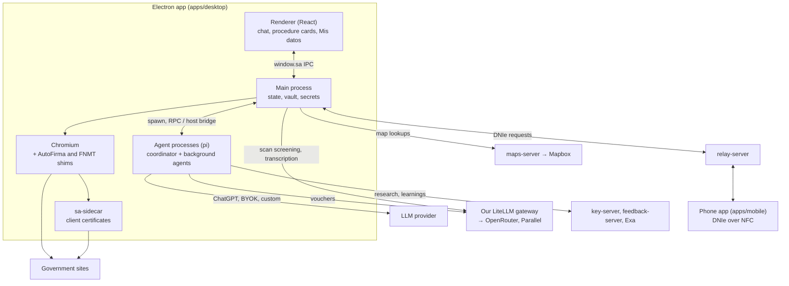

# SpainAssist — Architecture

A high-level map of how the app fits together. Details live in the code and in each package's
README; research and rejected options are in `docs/research/`.

## 1. Big picture

| Service | Role |
| --- | --- |
| LiteLLM gateway (`infra/`) | Voucher and ChatGPT-subsidy keys: chat to OpenRouter, search to Parallel, scan screening, phone-call transcription. Per-key budgets; stores no prompts. |
| `services/key-server` | Turns a voucher code into a capped gateway key, gives ChatGPT accounts their subsidy key, and sells Parallel research runs. Never sees conversations. |
| `services/feedback-server` | Anonymous, PII-scrubbed "learnings" shared between agents, with Spanish full-text search. |
| `services/maps-server` | Mapbox address lookups for map forms, so no Mapbox token ships in the app. |
| `services/relay-server` | Passes end-to-end encrypted frames between the desktop and the phone. No accounts. |
| `apps/mobile` | Reads the DNIe over NFC and signs what the desktop sends, after the user approves. |

## 2. Processes

- **Main** owns all state and secrets: settings, the encrypted vault, procedures, transcripts,
  the browser and the agent processes. It serves two APIs, both typed in `@sa/shared`:
  - the **renderer API** (`window.sa`, `ipc.ts`);
  - the **host bridge** (`bridge.ts`), loopback HTTP with one token per agent process. The token
    decides what that agent may call.
- **Renderer** is UI only. It never holds a secret; everything goes through `window.sa`.
- **Agent processes** run pi (`@sa/agent`) as Electron-as-Node. pi's coding tools are off; agents
  only have SpainAssist tools. Idle agents are stopped and resume from their session file.
  - **The coordinator**: one perpetual chat with the user. It never researches, browses or asks the
    user: with a few plain tools it starts and messages background agents, reads the procedures'
    cards and relays the agents' reports ([codemode.md](codemode.md)).
  - **Background agents**: independent of procedures, each with one tool, `codemode`, that runs
    resumable JavaScript workflows (QuickJS, in the agent's process) whose durable state main
    keeps. They research, browse, ask the user and create the procedures, which are durable
    records any agent may update (with versions), plus a private working context.
- **Browser**: the bundled Chromium (Chrome for Testing), with an isolated context per procedure,
  headless (`browser/routed.ts`). When the user needs to help (CAPTCHA, QR, manual step), "Abrir
  navegador" opens a live view of the page in the app (its screencast, taking the user's clicks
  and keys), and a CAPTCHA's prompt shows its screenshot, where the user can type it. A site that
  refuses the headless browser: the agent moves that procedure to a second, headed Chromium
  (`reopenHeaded`: cookies kept, the page reloaded, never as the first attempt), whose windows
  stay minimized until the user asks to see them. The app never downloads a browser: the
  Microsoft Store forbids downloading code.
- **sa-sidecar** (Go, `packages/sidecar`): a loopback TLS proxy per browser context that answers
  client-certificate requests with a `.p12` or the phone's DNIe.

**Shipping.** electron-builder (`apps/desktop/electron-builder.ts`) builds macOS, the Linux `.deb`,
and Windows twice: an NSIS installer on GitHub Releases and an MSIX for the Microsoft Store. NSIS
and `.deb` update themselves from GitHub Releases; the Store updates the MSIX. A `must-update`
flag can block old versions. A weekly workflow bumps playwright-core, which brings the new
Chromium.

Desktop releases use `vX.Y.Z` tags (`release.yml`); Android releases use `android/vX.Y.Z` tags
(`mobile-release.yml`). Their versions can stay aligned, but each app releases independently.

**Checks before users get a build.** Most of the app is tested on Linux, but users run it on
Windows and macOS, where the browser behaves differently: headed Chromium quits with its last
window on Windows and Linux, never on macOS nor headless (v0.3.2's browser died after every launch
on Windows). So:
- CI (`ci.yml`, every push to master) also runs the browser's tests headed (`SA_TEST_HEADED=1`,
  on Linux under xvfb and on Windows), the unit tests of every package the Windows app ships on
  Windows, and the e2e `parity` project (the agent's browser headed with a CRLSet, and the app's
  self-test) on Linux and Windows. Pull requests skip the Windows jobs.
- A release tag builds nothing until CI passed for its commit: the release waits for a run in
  progress and starts one when there is none (`scripts/ci-gate.mjs`).
- Each build runner installs what it built as users do (the NSIS installer silently, the `.deb`
  with apt, the signed `.app`) and runs `--self-test` (`src/main/app/self-test.ts`): on a
  temporary profile, next to any running copy and with nothing beyond loopback, the bundled
  Chromium must start headed and hidden with a CRLSet, keep running once its windows close, and
  serve a second session; sa-sidecar must proxy; on macOS the keychain library (koffi) must
  load, and on Windows the certificate store's (koffi, crypt32, ncrypt) must load and read the
  store. A failure stops the GitHub release and the Store
  submission.
- Not self-tested: the Store's MSIX. That would take signing it with a certificate for its
  publisher trusted on the runner, `Add-AppxPackage`, and an app execution alias (or
  `Invoke-CommandInDesktopPackage`) to pass `--self-test` and read its output from inside the
  package's container.

## 3. Key flows

### Conversation and delegation
The user talks only to the coordinator. For any request it starts a background agent with the
user's words as its brief; the agent works in the background and creates the procedures' cards
once it knows what the user needs. The coordinator reads the cards instead of asking agents,
passes on what the user says, and stops an agent only when the user asks. When an agent's run
ends, the coordinator gets a short report and tells the user in a sentence or two.

### Workflows
An agent writes a module (`export async function main(api)`); main
stores its memoized steps and the state of the interfaces it shows, the agent's host executes it
and long-polls the user's events. The agent's turn ends while the user answers; the workflow
continues by itself and its outcome reaches the agent as a message. After a restart, an
interface stays on screen and the workflow resumes from its state when the user acts on it. The
protocol is model-checked (`packages/agent/test/codemode-protocol.test.ts`). Details, decisions and
measurements: [codemode.md](codemode.md).

### Research and the card
An agent researches first, then plans, then asks for what's missing, then acts.
- Voucher users get `web_research` on Parallel, sold by the key server from the voucher.
- ChatGPT users get `web_research` with OpenAI's hosted web search, on their plan.
- BYOK and custom endpoints get Exa search (free, or with their own Exa key).

Its workflows can also read pages (`api.fetchUrl`), search the BOE, browse and search community
learnings. It records status, steps, requirements, sources and the next action on the card.

### Asking the user
Workflows ask in interfaces they render with the app's own components (forms, choices, maps,
appointment slots, document pickers), plus native prompts for confirmations, manual actions,
credential requests and phone calls. All of them show above the procedure cards ("Para ti"), not
tied to any procedure; what agents are doing shows in a meter apart from the cards
([codemode.md](codemode.md), "UI redesign"). Questions never block the chat. After a restart an
interface comes back with what the user typed and its workflow resumes from its state; a pending
native prompt is cancelled (its workflow hears it was interrupted).
- **Map choices**: the workflow gives addresses, main geocodes them through the maps server, and
  the user picks one. Mapbox results are never stored or sent to the agent: only the chosen value
  goes back.
- **Phone calls**: the prompt can record the call and transcribe it through the gateway. Audio is
  never stored.

### Credentials and certificates (the model never sees secrets)
Agents refer to credentials by id. Main checks the policy (ask first, Touch ID when available), the
domain allowlist for that credential kind, and the input type, then types the secret itself.
Snapshots mask it. A Cl@ve Permanente login is one call (`browser_login_clave`): main types the
saved DNI/NIE and password, and when none is saved, or the site rejected it, the user adds or
corrects it in the app's own form (the DNI/NIE prefilled when known). No tool asks for the Cl@ve
password alone. One-time codes and passwords of other sites are typed once from a native prompt
and never saved. Client-certificate logins go through the sidecar after consent. Sites outside
`OFFICIAL_DOMAINS` need independent official sources and the user's explicit approval.
Mis datos can export a certificate, key and chain included, as a `.p12` under a password the user
types twice and the app never keeps (Touch ID first when available, then the OS save dialog). The
file uses 3DES and a SHA-1 MAC, since older macOS, Windows and Java (AutoFirma) reject AES ones
(`exportPkcs12` in `@sa/vault`).

**External certificates (macOS, Windows).** Main also looks in the keychain, or on Windows in
the current user's certificate store (`CurrentUser\My`), for FNMT certificates that have
a private key (`os-certificates/`), silently: at startup and whenever Mis datos loads. It lists
them as `certificate` credentials marked `external` (`withOsCertificates` wraps the vault, so the
agent, logins and signatures see them like any other). Their keys never enter the app:
- main calls Security.framework in-process through koffi (`keychain.ts`), and on Windows
  crypt32 and ncrypt (`windows-store.ts`, CNG, which also opens the keys of Microsoft's older
  CAPI providers); a login signs each TLS
  handshake through the sidecar's remote-key calls and a document through `ExternalSigningKey`,
  the DNIe's two paths, with an RSA PKCS#1 v1.5 signature from the system's key;
- finding one needs no consent, using one always asks (policy `ask`, not changeable), and macOS
  may ask once more the first time the app uses a key another program installed;
- a certificate that is also in the vault shows once, as the vault's (`inSystem`). Expired ones
  aren't listed;
- Mis datos can't download, delete or change them, and marks them "Externo" with the system's
  logo; the label opens Acceso a Llaveros, or `certmgr.msc` on Windows.

A vault certificate's menu ("Más opciones": download, move, delete) offers "Mover al sistema
operativo" (`vault/certificate-move.ts`): after
a dialog that explains it (and Touch ID), main imports a 3DES `.p12` made in memory into the login
keychain (`SecItemImport`, extractable, so Acceso a Llaveros can still export a backup), and
deletes the vault's copy only once it has found the certificate there and signed with it. Only
certificates the app would then find again (FNMT, RSA) can be moved. One that is already in the
keychain can be neither moved nor deleted: its menu offers "Usar el del sistema operativo", which
deletes the vault's copy only after the keychain's has proven to be the same certificate, byte
for byte, and to sign with its key (`OsCertificates.prove`).

Windows has everything but the move: the store is only read (`OsKeyStore.importPkcs12` is
absent, so no certificate is `canMoveToSystem`). The Store build is an MSIX, and Windows keeps
what a packaged app writes to the user's registry, where that store lives, private to the app:
no other program would see a moved certificate. The user imports the downloaded `.p12`
themselves. Reads aren't redirected, so finding, signing and "Usar el del sistema operativo"
work. Research in `docs/research/os-certificate-store.md`. Tests and e2e runs use a throwaway keychain file
(`SA_OS_KEYCHAIN`), never the user's keychains; e2e runs on Windows read no store, and the
Windows unit test fills a throwaway store of its own with `certutil`.

### Signing (AutoFirma replacement)
Every page gets an AutoScript shim (`@sa/signer`) before its own scripts. When a site asks
AutoFirma to sign, the user approves in the app, `@sa/signer` signs with the `.p12` (CAdES, XAdES
or PAdES), and the site gets the result as if AutoFirma had produced it. Some sedes log in this way
too.

### FNMT certificates (Configurador replacement)
FNMT's request page asks its Configurador for a key and a
PKCS#10 through `FnmtCertRequest`; a shim (`@sa/signer`) answers instead. After the user approves,
main (`fnmt/broker.ts`) makes the key, keeps it in the vault as a pending certificate request
(it must outlive the procedure and restarts: the identity check can take days) and gives the page
the request, which the page sends to FNMT. At download, the page hands over the certificate: main
finds the pending key by its public key, builds the path from the FNMT CAs it ships, and stores
an ordinary certificate credential without asking (the request was the consent; a notice says
it's saved). It answers base64 of `OK`, as the Configurador does, which the page checks. Only
FNMT's sedes may ask (`certificateRequestAllowedOn`). Research and design: `docs/research/fnmt.md`.
Until its certificate arrives, Mis datos → Credenciales shows a request as "En proceso", and the
user can discard it with its key.

### DNIe with the phone
Behind the `dnie-phone` flag, whose variant sets the stage (`DniePhoneStage`): `prerelease`
shows an "Acceso anticipado" card in Mis datos instead of "Lo tengo", and offers the DNIe once the
user saves it, which they do once they have the phone app (a closed test); `release`, or the flag on without a variant, offers it to everyone. The
user pairs the phone with a one-time QR. Signatures and
certificate logins then go to the phone over the relay, end-to-end encrypted, and the phone reads
the card over NFC after the user approves.
- The CAN and the PIN are typed on the desktop and kept there (the PIN in the vault). They reach
  the phone only inside the encrypted channel, per request.
- Agents have no path to either.

Protocol: `packages/companion/README.md`.

### Document scanning
The user scans an ID document (DNI, TIE, passport, driving licence) with the camera or a photo.
1. A cheap decision model screens each camera frame (is there a document, is it legible): the
   models file's `decider` of the user type, which the key server's keys allow (see Models).
2. A small, isolated scanning agent reads the fields from the accepted frames. It asks for
   another side or a closer frame until it has what it needs. On ChatGPT, Codex and vouchers it
   runs the models file's `scanner` model at its level (see Models); API keys and custom
   endpoints use the user's model, with reasoning off or at its lowest.
3. Field and document rules (`apps/desktop/src/main/scanner/rules.ts`) reject misreads.
4. Valid fields go straight to the vault.

Packaged builds keep no scan images. Code: `apps/desktop/src/main/scanner/`. Research:
`docs/research/scan-frame-gate.md` and `identity-document-fields.md`.

### Learnings
At the end of a procedure (or after friction) an agent can share a learning. It is scrubbed of PII
twice on the device (patterns with checksums, and every value in the vault), then again on the
server. A maintainer approves each one on the feedback server's admin page before agents get it.
Future agents search approved learnings and vote on the ones they used. Searching, sharing and
voting respect the user's sharing setting; sharing and voting also require a user key.

## 4. Users and our services

Our services know a user by their key on our LiteLLM gateway, turned into a pseudonymous id
(`@sa/gateway-keys`).

| Provider | User key |
| --- | --- |
| Voucher | The voucher key |
| ChatGPT | The account's subsidy key from the key server (one per OpenAI account) |
| Codex (development builds only) | `SA_DEV_USER_KEY`, if set |
| BYOK, custom endpoint | None |

Without a user key these are off: scan screening, phone-call transcription, map pins, and sharing
or rating learnings (searching still works).

## 5. Feature flags, models and error reports

- **Feature flags.** Main reads flags from Unleash once per launch; a change applies at the next
  launch. Flags can target an app version, OS, CPU or install channel. When Unleash can't be
  reached, every flag is off. Main enforces the flags itself; the UI only hides what main already
  refuses. Flags are listed in `FeatureFlags` (`@sa/shared`).
- **Models.** The models of ChatGPT, Codex and vouchers (background agents, the coordinator, the scanner, ChatGPT
  research modes) are lists in the repository's `models_warningUpdatingThisWillChangeItInAllClientsOnPushToMaster.json`, best first. Each build bundles
  it, and packaged builds download it from master on GitHub at most once an hour (the bundled or
  last read one when GitHub fails), so **a push that changes it changes every installed app**. A
  ChatGPT account runs each list's first model its plan offers (`packages/agent/README.md`).
- **Error reports.** Packaged builds send crashes and uncaught errors to our GlitchTip (Sentry
  protocol), when both the `error-reports` flag and the user's anonymous learnings sharing setting are
  on. Only errors are sent: no breadcrumbs, no tracing, no memory dumps. Every event is scrubbed with `@sa/pii`.

## 6. Development tooling

- **Browser capture** (`SA_BROWSER_CAPTURE=1`, development builds only) records each procedure's
  browsing (HAR, page HTML, actions, trace) to build offline mock sites. Typed secrets are
  scrubbed, but **personal data is kept**: use it only with synthetic or throwaway accounts.
  Captures never leave the device.
- **Headless app and eval hooks.** `createHeadlessApp` (`@sa/desktop/headless`) runs the app's
  logic without a window or the internet. `HostHooks` let a harness stub the agent host's network.
  The SpainBench eval suite builds on both (`docs/EVAL.md`). Neither ships in the packaged app.
- **Agent playground.** The web preview's `?playground=1` (`corepack pnpm playground`) runs example
  workflows in the real kernel (QuickJS in the page, main's side played by
  `features/playground/runner.ts`): their interfaces in the real "Para ti" boxes, editable source,
  a log of host calls, durable state, and a resume that re-runs from it. It also shows the
  questions the host still asks (`api.user.*`, certificates, the DNI), procedure rows, the agent
  meter and the coordinator's chat. Only the web preview allows WebAssembly in its CSP.

## 7. Security model

- **Data stays local.** Personal data stays on the device, except what the user's chosen
  inference provider needs (including document images) and what a procedure sends to the
  administration. Voucher inference passes through our gateway, which keeps no prompts. Shared
  learnings are anonymous.
- **Encryption.** Vault data, documents, credentials and provider tokens are encrypted at rest
  with a data key wrapped by the OS (Keychain, DPAPI or libsecret). Linux without a keyring is
  flagged as insecure.
- **Secrets.** The model never receives secrets. Credentials work only on allow-listed official
  domains. Certificate use and signatures need explicit approval.
- **Least privilege.** Agent processes get only their bridge URL and token, a provider key and the
  language. The coordinator can't reach the browser, the signer, credentials or the user's data;
  it may only call its agents and read the cards (`codemodeMayCall`). Background agents can't
  start or message other agents.
- **Untrusted web content.** Agents have no shell or file tools, domain checks, and confirmations
  for irreversible actions. Model-written workflows run in a sandboxed QuickJS in the agent's
  process, with network access only through the host's checks (`api.fetchUrl`, `api.fetch`);
  their page code runs only in the page.
- **Known gaps.** Procedure metadata, transcripts, screenshots, pi session files, workflow records
  and development captures are private local files but not encrypted.
