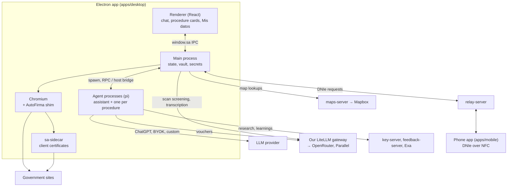

# SpainAssist — Architecture

A high-level map of how the app fits together. Details live in the code and in each package's
README; research and rejected options are in `docs/research/`.

## 1. Big picture

| Service | Role |
| --- | --- |
| LiteLLM gateway (`infra/`) | Voucher and ChatGPT-subsidy keys: chat to OpenRouter, search to Parallel, scan screening, phone-call transcription. Per-key budgets; stores no prompts. |
| `services/key-server` | Turns a voucher code into a capped gateway key, gives ChatGPT accounts their subsidy key, and sells Parallel research runs. Never sees conversations. |
| `services/feedback-server` | Anonymous, PII-scrubbed "learnings" shared between agents, with Spanish full-text search. |
| `services/maps-server` | Mapbox address lookups for map forms, so no Mapbox token ships in the app. |
| `services/relay-server` | Passes end-to-end encrypted frames between the desktop and the phone. No accounts. |
| `apps/mobile` | Reads the DNIe over NFC and signs what the desktop sends, after the user approves. |

## 2. Processes

- **Main** owns all state and secrets: settings, the encrypted vault, procedures, transcripts,
  the browser and the agent processes. It serves two APIs, both typed in `@sa/shared`:
  - the **renderer API** (`window.sa`, `ipc.ts`);
  - the **host bridge** (`bridge.ts`), loopback HTTP with one token per agent process. The token
    decides what that agent may call.
- **Renderer** is UI only. It never holds a secret; everything goes through `window.sa`.
- **Agent processes** run pi (`@sa/agent`) as Electron-as-Node. pi's coding tools are off; agents
  only have SpainAssist tools. Idle agents are stopped and resume from their session file.
  - **The assistant**: one perpetual chat with the user. It never researches or browses. It starts,
    briefs and steers procedure agents, and relays their reports.
  - **Procedure agents**: one per active procedure. They do the research, the browsing and the
    forms, and keep the procedure's card up to date. Their activity goes to the card, not the chat.
- **Browser**: one bundled Chromium (Chrome for Testing), with an isolated context per procedure.
  Its windows stay minimized unless the user needs to help (CAPTCHA, QR, manual step). The app never
  downloads a browser: the Microsoft Store forbids downloading code.
- **sa-sidecar** (Go, `packages/sidecar`): a loopback TLS proxy per browser context that answers
  client-certificate requests with a `.p12` or the phone's DNIe.

**Shipping.** electron-builder (`apps/desktop/electron-builder.ts`) builds macOS, the Linux `.deb`,
and Windows twice: an NSIS installer on GitHub Releases and an MSIX for the Microsoft Store. NSIS
and `.deb` update themselves from GitHub Releases; the Store updates the MSIX. A `must-update`
flag can block old versions. A weekly workflow bumps playwright-core, which brings the new
Chromium.

## 3. Key flows

### Conversation and delegation
The user talks only to the assistant. For a new need it starts a procedure with a brief; a
procedure agent then works in the background. The assistant reads procedure cards instead of
asking their agents, passes on new information, and can resume, stop or cancel a procedure. When a
run ends, the assistant gets a short report and tells the user in a sentence or two.

### Research and the card
A procedure agent researches first, then plans, then asks for what's missing, then acts.
- Voucher users get `web_research` on Parallel, sold by the key server from the voucher.
- ChatGPT users get `web_research` with OpenAI's hosted web search, on their plan.
- BYOK and custom endpoints get Exa search (free, or with their own Exa key).

It can also read pages (`fetch_url`), search the BOE, browse read-only and search
community learnings. It records status, steps, requirements, sources and the next action on the
card.

### Asking the user
Agents ask through native prompts: forms, confirmations, manual actions, credential requests and
phone calls. Procedure prompts show on the card; the assistant's show in the chat. Questions never
block the chat. Unanswered forms and phone calls survive a restart.
- **Forms** can fill from and save to the vault through `vaultKey` fields; secrets and documents
  are never saved from answers.
- **Map choices**: the agent gives addresses, main geocodes them through the maps server, and the
  user picks one. Mapbox results are never stored or sent to the agent: only the chosen value
  goes back.
- **Phone calls**: the card can record the call and transcribe it through the gateway. Audio is
  never stored.

### Credentials and certificates (the model never sees secrets)
Agents refer to credentials by id. Main checks the policy (ask first, Touch ID when available), the
domain allowlist for that credential kind, and the input type, then types the secret itself.
Snapshots mask it. A Cl@ve Permanente login is one call (`browser_login_clave`): main types the
saved DNI/NIE and password, and when none is saved, or the site rejected it, the user adds or
corrects it in the app's own form (the DNI/NIE prefilled when known). No tool asks for the Cl@ve
password alone. One-time codes and passwords of other sites are typed once from a native prompt
and never saved. Client-certificate logins go through the sidecar after consent. Sites outside
`OFFICIAL_DOMAINS` need independent official sources and the user's explicit approval.

### Signing (AutoFirma replacement)
Every page gets an AutoScript shim (`@sa/signer`) before its own scripts. When a site asks
AutoFirma to sign, the user approves in the app, `@sa/signer` signs with the `.p12` (CAdES, XAdES
or PAdES), and the site gets the result as if AutoFirma had produced it. Some sedes log in this way
too.

### DNIe with the phone
Behind the `dnie-phone` flag, whose variant sets the stage (`DniePhoneStage`): `prerelease`
shows an "Acceso anticipado" card in Mis datos instead of "Lo tengo", and offers the DNIe once the
user saves it, which they do once they have the phone app (a closed test); `release`, or the flag on without a variant, offers it to everyone. The
user pairs the phone with a one-time QR. Signatures and
certificate logins then go to the phone over the relay, end-to-end encrypted, and the phone reads
the card over NFC after the user approves.
- The CAN and the PIN are typed on the desktop and kept there (the PIN in the vault). They reach
  the phone only inside the encrypted channel, per request.
- Agents have no path to either.

Protocol: `packages/companion/README.md`.

### Document scanning
The user scans an ID document (DNI, TIE, passport, driving licence) with the camera or a photo.
1. A cheap decision model screens each camera frame (is there a document, is it legible): the
   models file's `decider` of the user type, which the key server's keys allow (see Models).
2. A small, isolated scanning agent reads the fields from the accepted frames. It asks for
   another side or a closer frame until it has what it needs. On ChatGPT, Codex and vouchers it
   runs the models file's `scanner` model at its level (see Models); API keys and custom
   endpoints use the user's model, with reasoning off or at its lowest.
3. Field and document rules (`apps/desktop/src/main/scanner/rules.ts`) reject misreads.
4. Valid fields go straight to the vault.

Packaged builds keep no scan images. Code: `apps/desktop/src/main/scanner/`. Research:
`docs/research/scan-frame-gate.md` and `identity-document-fields.md`.

### Learnings
At the end of a procedure (or after friction) an agent can share a learning. It is scrubbed of PII
twice on the device (patterns with checksums, and every value in the vault), then again on the
server. A maintainer approves each one on the feedback server's admin page before agents get it.
Future agents search approved learnings and vote on the ones they used. Searching, sharing and
voting respect the user's sharing setting; sharing and voting also require a user key.

## 4. Users and our services

Our services know a user by their key on our LiteLLM gateway, turned into a pseudonymous id
(`@sa/gateway-keys`).

| Provider | User key |
| --- | --- |
| Voucher | The voucher key |
| ChatGPT | The account's subsidy key from the key server (one per OpenAI account) |
| Codex (development builds only) | `SA_DEV_USER_KEY`, if set |
| BYOK, custom endpoint | None |

Without a user key these are off: scan screening, phone-call transcription, map pins, and sharing
or rating learnings (searching still works).

## 5. Feature flags, models and error reports

- **Feature flags.** Main reads flags from Unleash once per launch; a change applies at the next
  launch. Flags can target an app version, OS, CPU or install channel. When Unleash can't be
  reached, every flag is off. Main enforces the flags itself; the UI only hides what main already
  refuses. Flags are listed in `FeatureFlags` (`@sa/shared`).
- **Models.** The models of ChatGPT, Codex and vouchers (procedures, the assistant, the scanner, ChatGPT
  research modes) are lists in the repository's `models_warningUpdatingThisWillChangeItInAllClientsOnPushToMaster.json`, best first. Each build bundles
  it, and packaged builds download it from master on GitHub at most once an hour (the bundled or
  last read one when GitHub fails), so **a push that changes it changes every installed app**. A
  ChatGPT account runs each list's first model its plan offers (`packages/agent/README.md`).
- **Error reports.** Packaged builds send crashes and uncaught errors to our GlitchTip (Sentry
  protocol), when both the `error-reports` flag and the user's anonymous learnings sharing setting are
  on. Only errors are sent: no breadcrumbs, no tracing, no memory dumps. Every event is scrubbed with `@sa/pii`.

## 6. Development tooling

- **Browser capture** (`SA_BROWSER_CAPTURE=1`, development builds only) records each procedure's
  browsing (HAR, page HTML, actions, trace) to build offline mock sites. Typed secrets are
  scrubbed, but **personal data is kept**: use it only with synthetic or throwaway accounts.
  Captures never leave the device.
- **Headless app and eval hooks.** `createHeadlessApp` (`@sa/desktop/headless`) runs the app's
  logic without a window or the internet. `HostHooks` let a harness stub the agent host's network.
  The SpainBench eval suite builds on both (`docs/EVAL.md`). Neither ships in the packaged app.
- **Agent UI playground.** The web preview's `?playground=1` shows every prompt, message and card
  component against a mock conversation.

## 7. Security model

- **Data stays local.** Personal data stays on the device, except what the user's chosen
  inference provider needs (including document images) and what a procedure sends to the
  administration. Voucher inference passes through our gateway, which keeps no prompts. Shared
  learnings are anonymous.
- **Encryption.** Vault data, documents, credentials and provider tokens are encrypted at rest
  with a data key wrapped by the OS (Keychain, DPAPI or libsecret). Linux without a keyring is
  flagged as insecure.
- **Secrets.** The model never receives secrets. Credentials work only on allow-listed official
  domains. Certificate use and signatures need explicit approval.
- **Least privilege.** Agent processes get only their bridge URL and token, a provider key and the
  language. The assistant can't reach the browser, the signer or credentials. Procedure agents
  can't start or message other procedures.
- **Untrusted web content.** Agents have no shell or file tools, domain checks, and confirmations
  for irreversible actions. Model-written scripts run in a sandboxed QuickJS with network access
  only through `fetch_url`'s checks.
- **Known gaps.** Procedure metadata, transcripts, screenshots, pi session files and development
  captures are private local files but not encrypted.
