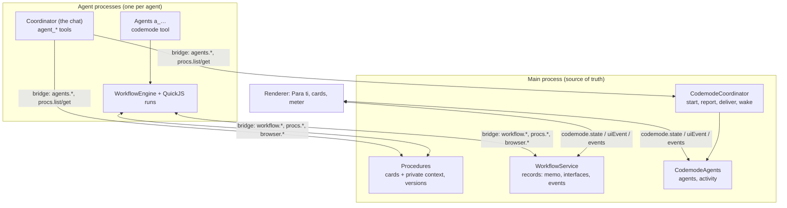

# Codemode

Status: the app's only harness. Built behind a `codemode` feature flag (2026-11-08) and shipped to
everyone on 2026-11-14, when the flag and the classic harness (an assistant that started one agent
per procedure, one tool call per step) were removed. Research and the options considered:
[research/codemode.md](research/codemode.md). This page is the design as built, the decisions taken
without asking (to review, in [Decisions for review](#decisions-for-review)), and how it was
verified.

Profiles from before keep their procedures' cards and the chat the user sees. The classic
assistant's model context (`assistant/session.jsonl`), the procedures' agent sessions and their
pending questions are not carried over: the coordinator starts a fresh context with the cards on
its first message, and a procedure left half done is continued by asking for it in the chat.

## What changed from the classic harness

| Classic harness | Codemode |
| --- | --- |
| One agent per procedure; the procedure is the agent's | Procedures are durable records; agents work on any of them, one agent can serve several |
| One tool call per step, a model turn after each | One `codemode` tool: a JavaScript module does many steps (in parallel where it can) without a turn in between |
| A form blocks the agent's turn; every answer costs a turn before the next step | Interfaces are rendered by the workflow itself; the workflow continues after the answer with no turn, and the agent's turn ends while the user answers |
| The assistant asks before it starts a procedure | The coordinator only delegates (plain tools, no codemode): agents research, ask in interfaces and create the cards once they know the plan; the coordinator never asks ([The coordinator](#the-coordinator)) |
| A form survives a restart as a prompt; the agent gets a new message | A workflow resumes from its state: memoized steps are not repeated, open interfaces come back with what the user typed; native prompts (a confirmation, a phone call) are cancelled and the workflow hears it was interrupted |
| Questions on each card | Every question in one place above the cards ("Para ti", no heading), not tied to any procedure |

Measured on the same task, in the real app (see [Empirical verification](#empirical-verification)):
the first question reaches the user twice as soon (6.4 s against 13.9 s), with 8 model calls instead
of 9.

## Architecture

- **Roles.** The coordinator is the chat's agent (`assistant`; version 2 of the chat, see
  [The coordinator](#the-coordinator)): it only delegates, with six plain tools. Background agents
  (`a_…`) are started by the coordinator for a piece of work, create its procedures and drive their
  pages themselves (no subagents: see [decision 15](#decisions-for-review)). Every agent has a
  single tool, `codemode`, and the declaration of its API in its system prompt
  (`packages/agent/src/codemode/declarations.ts`, `prompt/codemode.ts`).
- **Where workflows run.** In the process of the agent that runs them: a fresh QuickJS
  (WebAssembly) instance per run, the same sandbox `run_script` used, with a CPU slice limit
  instead of a wall-clock limit (a run may wait hours for the user). Main is the source of truth:
  every durable change goes to it before the workflow continues, so a run is only an executor.
  Model-written code never runs in main.
- **Durable records, independent of agents.** `workflows/<id>.json` (memo, interfaces with their
  latest tree and durable values, result, status), `agents/<id>/` (record, activity log, pi
  session), `procedures/<id>/context.json` (the private working context).

### A run's life

1. `codemode({ workflow, title, procedures, source })` → `workflow.begin`: the record is created,
   or resumed with its state (same id = resume). A live run of it in another living process is
   refused (`conflict`).
2. The module's `main(api)` runs. `api.state.memo(key, fn)` stores the value in main before
   resolving; later runs get it without running `fn`. `api.ui.present(key, render)` renders the
   interface to a tree, sends it (main validates it and locates map addresses before the renderer
   sees it) and waits; a closed key returns its stored result.
3. The host long-polls the user's events (`workflow.events`) and dispatches them into the run;
   handlers update durable state (`useDurableState`, stored in main) and re-render.
4. The tool call returns when `main` ends, or **detaches** when the workflow waits for the user (or
   after 2 minutes): the agent's turn ends and the workflow keeps running. When it ends, main gives
   its outcome to the agent as a message (`[Workflow "id" succeeded]`), with the run's console
   output and the notes the user left on actions (a captcha's characters), which reach the agent
   even when the workflow's code drops them.
5. If the process goes away (idle, crash, provider change, app restart), main keeps the record: a
   waiting workflow stays on screen; when the user acts on it, main wakes its agent, whose host
   resumes it (re-runs it from its state, which reaches the open interface without repeating
   anything memoized) and gets the queued events. A workflow that was running is `interrupted`;
   its agent hears it with its next message and decides.

### Determinism without a journal

Everything durable is keyed by an explicit name (memo keys, interface keys, durable names), never
by call order. That makes `Promise.all`, races and parallel interfaces replay-safe, which a
positional journal (Cloudflare's design) is not. Memoized values are JSON round-tripped on the first
run too, so first runs and replays see identical values. What is not memoized runs again on a
re-run: idempotent reads and card updates are fine; anything that must not repeat (a submission, a
payment) goes in `api.state.memo`. That is the contract the prompts teach.

## The API

The full declaration is generated for agents (`declarations.ts`, 17 k characters). In short:

- `api.state`: `memo`, `get`, `set`, `delete`, `keys`.
- `api.ui`: `present(key, render)`, `close(result, key?)`, hooks `useDurableState`, `useState`,
  `useMemo`; components from `@spainassist/ui`: Form, Section, Text, Callout, Facts, Link, Divider,
  Progress, TextField, Select, Choice, MultiChoice, Checkbox, Province, DocumentPicker, Map,
  Appointment, Actions, Button. JSX, no other imports.
- `api.procedures`: `list`, `get`, `getOrCreate({ id, title, …card })`, and handles with `update`
  (optimistic concurrency), `refresh`, `context`/`setContext` (private working context).
- `api.parallelize(tasks, { concurrency })` (allSettled with a limit), `api.setStatus(status)` (the
  agent's line on the meter, an ongoing action: "Analizando la página de Correos…"; the
  coordinator sets it in `agent_start` and `agent_message`), `api.output.image(image)`.
- `api.search`, `api.fetchUrl`, `api.fetch` (public HTTP, the old run_script fetch), `api.boe`,
  `api.vault`, `api.documents`, `api.feedback`, `api.workflows`.
- Agents: `api.browser.currentPage()` → a Playwright-shaped `Page` (locators:
  `getByRole`, `getByLabel`, `getByText`, `locator`, `filter`, `nth`…; actions: `click`, `fill`,
  `selectOption`, `check`, `setInputFiles(documentIds)`; reads: `textContent`, `count`,
  `allTextContents`, `evaluate`…; `snapshot()`, the one way to look at a page; the app-typed secrets
  `fillFromVault`, `loginClave`, `fillFromUser`; `useCertificate`), `api.user.confirm`,
  `requestAction`, `requestCredential`, `phoneCall`.
- No `api.agents`: only the coordinator starts agents, with its own tools.

Errors are `CodemodeError { code, message, op, effect: "not_started" | "applied" | "unknown" }`.

## The coordinator

The chat's agent only delegates. It has no codemode: one call per turn needs no workflow, and a
weak model does better with six tools than with a `.d.ts` (`packages/agent/src/tools/coordinator.ts`,
`prompt/coordinator.ts`):

| Tool | For |
| --- | --- |
| `agent_start(title, brief, procedures?)` | Any request: something to do or only to know. The brief is the user's words |
| `agent_message(agentId, message, urgent?)` | Anything more the user says: an answer, news, a correction |
| `agent_stop(agentId)` | Only when the user asks |
| `agent_list()` | The agents, to find the one to message |
| `procedure_list()`, `procedure_read(id)` | The cards, read-only: "¿cuándo es mi cita?" needs no agent |

No research, interfaces, vault, approvals or procedures of its own; the bridge refuses those
methods to it too (`codemodeMayCall`). Agents narrow the request down (research, then one interface
for what research can't answer) and create the cards with `api.procedures.getOrCreate` once they
know which procedures the user has. A question that only wants information is answered by the
agent's report, which the coordinator relays.

- **It never asks in chat.** A chat question stops everything until the user answers, while an
  interface lets the work go on. The prompt says so; the host doesn't enforce it. A check that
  made the model start or message an agent and write the message again was removed: on a turn
  relaying a report there were no user words to pass on, so the model made up an instruction
  for the agent, which then overrode the user for the rest of the session (2026-11-10).
- **Chat versions.** The chat the user sees (`assistant/transcript.json`) is one for every
  version of the chat's agent; its model context is not (`CHAT_VERSION`, `app/paths.ts`): version
  1, the classic assistant, left `assistant/session.jsonl`, no longer read; version 2, this
  coordinator, `assistant/session-v2.jsonl`. A new version starts with a fresh context, so it never reads back
  calls of tools it no longer has (the first codemode coordinator's `codemode` calls, in
  `assistant/codemode-session.jsonl`, are left unread). The procedures' cards ride on its first
  message, so it still knows what the user has going.

## Procedures, decoupled

- A procedure is a card the user sees plus a **private working context** (notes and data for
  agents, never shown), readable by every agent on demand.
- **Optimistic concurrency.** Every change bumps `version`; `procedure.update` sends the version it
  read and gets `conflict` when anyone changed the card since (another agent, the user renaming
  it). The spec's "lease" is this compare-and-swap: a workflow that waited an hour for the user
  cannot overwrite what happened meanwhile.
- **Stable keys.** `getOrCreate({ id: "renovar-dni" })` maps the key to
  `p_` + sha256(workflow id, key): the same procedure on every run of that workflow, whoever runs
  it, so restarting or replacing an agent never recreates it. A full id gets an existing one.
- **What agents read.** Every agent's first message carries the cards (status, current step, what
  is missing, the next action); later messages carry them again only when they changed. Private
  context is always on demand.

## Interfaces and where they appear

Workflows render native components only: main validates every tree (`uiTreeProblem`, zod schemas
per component, size and depth limits) and the renderer draws it with the app's own controls (map
with pins, appointment slots, document picker with scanning…). Text is never HTML. Handlers are
ids; the user's events go back through main. Inputs keep what the user types locally, so typing
never waits for a round trip.

A tree can pass validation and still make the renderer fail (a value one of its controls can't
show). Each node renders inside an error boundary: the interface leaves the screen and the
renderer tells main (`codemode.uiFailed`, naming the component, its label and the workflow's
components that rendered it), which sends the run an event with the reserved handler `UI_FAILED`.
The kernel then rejects that interface's `present` with a `CodemodeError` whose stack is the
`present` call's, exactly as if main had refused the tree: the workflow throws at that line, and
can catch it. With no run, main wakes the agent; the resumed run presents the interface again
and hears the failure then.

**Decision: questions are not tied to procedures** (the classic design kept each procedure's
questions on its card). Every interface and native prompt appears above the procedure cards, in a section the code calls **"Para ti"** (`ForYou.tsx`) and
the screen shows without a heading: the questions' boxes are enough. A question doesn't say which procedure it is
for, and cards don't point to their questions: the question's own title says what it is about
("Cita para renovar el DNI"), which is usually obvious. Workflows still record the procedures they
serve (their identity references them, and the coordinator reads it), but the renderer never
receives that list, and a document the user adds in an interface is saved to Mis datos without a
procedure. An earlier version labelled each question with its workflow's procedures. It
was dropped as complexity without enough use: a workflow serving several procedures labelled every
question with all of them, and the labels depended on which procedures the model declared.

## Browser

The workflow's sandbox builds Playwright locators as data (`["getByRole","button",{"name":"Enviar"}]`)
and the app replays them on the real page with the real Playwright API
(`packages/browser/src/locator.ts`), so waiting, strictness and errors are Playwright's. Only the
listed steps exist; nothing reaches the context, the browser or other procedures. Locator targets go through the same bridge handlers as every page action (domain allowlists,
input type checks, approvals).
The browser is headless; `page.reopenHeaded()` moves the procedure to a headed Chromium when a
site refuses it, and only after a headless attempt (`apps/desktop/src/main/browser/routed.ts`).

**`evaluate` and secrets.** Page code is allowed (structured extraction is one of codemode's main
wins) and runs only in the page: the app gives Playwright a function whose `toString()` is the
model's source, which Playwright serializes and never calls in main. While a secret the app typed
is in the page's current document, `evaluate` is refused; `inputValue`/`getAttribute('value')` on
password or secret fields are always refused; results are masked. That keeps the documented
guarantee that model-written code cannot obtain a typed credential.

## UI redesign

Follows the three exploration screenshots (a list of cards, a card's requirements popover, a
completed card with its details open). It lives in `features/codemode`
(`ProceduresView`, `ProcedureRow`, `ProcedureDetails`, `OutcomePill`) and reuses the card's menu,
rename and appointment links (`features/procedures/CardParts.tsx`) and the empty state
(`EmptyProcedures.tsx`) of the classic design, which was removed with the flag (decision 13).

- **Cards are rows, not boxes:** the procedures are one list separated by thin dividers. Each has
  its title and administration, a status pill only when it ended or stopped ("Completado",
  "Bloqueado", "Cancelado", a problem), and the menu.
- **Two columns.** Left: the key facts as bullets ("Coste: Gratis."). The summary shows there only
  while there are no facts yet; otherwise it moves into the details. Right: **what needs doing**. A
  problem, "Siguiente: …" (with the current step's detail under it, and Maps/Calendar for an appointment)
  or what the administration is doing, and **"Necesitas"**: a box with each missing requirement
  and its detail. The last row, "+ 3 requisitos", opens a popover on hover or click with the
  others (the ones the user has, those not needed, missing ones past the fourth). Narrow panes
  stack the columns.
- **"Detalles"** (bottom right) folds the rest: the summary, the plan's steps on the left,
  documents and official sources on the right, and the requirements when none is missing (with
  something missing they are already in the box above).
- **The agent meter is apart from the cards:** a small panel floating at the bottom of the
  procedures pane while anything works, one row per piece of work ("Empadronarme en Madrid ·
  Leyendo sede.madrid.es") with a spinner and a round stop button. After three rows it shows "Ver N más". A row's title leads to its card. Cards no longer carry a "Trabajando" mark or the meter's details.
- **"Para ti"** (see above) stays above the list without a heading, its questions in boxes so
  they stand out from the rows, with no procedure labels. The tab badge counts its interfaces and the cards whose turn is
  the user's.
- Choices the screenshots left open: where questions go (still "Para ti", decision 5), the summary
  (moved into the details rather than dropped), the elapsed time in the meter (dropped, as in the
  screenshots), and what the right column shows when nothing is missing (no box: the requirements
  go into the details).

## Verification

### Formal verification

`packages/agent/test/helpers/protocol-model.ts` models the protocol as transition rules (main's
`WorkflowService` and the hosts' `WorkflowEngine`): one workflow
`read → memo a → ui q → memo b (a submission) → update procedure → end`, two agent processes, the
user, and bounded faults (process crashes, app restarts, a run its host loses without telling main,
someone else updating the procedure). A breadth-first explicit-state search checks on every state:

- a stored memo value is never recomputed (at most once, plus once per fault during its effect);
- an answered interface never opens again;
- never two live runs of a workflow;
- a finished workflow shows no interface; "waiting for the user" always has one on screen;

and on the state graph, without any further fault: an open interface can always be answered, and
the workflow can always end.

**It found a real bug.** The original rules failed liveness with a two-step counterexample
(`codemode 0 → zombie 0`): a run whose host lost it without its `workflow.end` reaching main kept
receiving the user's events, and an agent whose process stayed up never resumed a waiting workflow
(hosts resumed only at startup). Fixes: main sweeps for runs that stopped polling (a running one
becomes `interrupted` and its agent is told; a waiting one stays on screen and its events go to the
next run); hosts look for workflows to resume every 15 s; an ended run answers its host's poll with
`ended` (it answered `not_found`, which the host retried forever).

| Rules | Fault budget | States | Transitions | Violations |
| --- | --- | --- | --- | --- |
| Original | 1 crash, 1 restart, 1 lost run, 1 concurrent update | 23,946 | 82,730 | 2 (liveness) |
| Fixed | same | 41,491 | 145,143 | 0 |
| Fixed | 2 crashes, 1 restart, 1 lost run, 1 update | 108,697 | 412,731 | 0 |
| Fixed | 2 crashes, 2 restarts, 2 lost runs, 1 update | 553,253 | 2,290,613 | 0 |

The model is an abstraction: it is as good as its correspondence with the code. Two checks close
the gap: a randomized property test runs 60 seeded random workflows (parallel memo groups and
interfaces) on the **real** runtime, cancelling them at random points and resuming from the stored
state, and checks the same properties plus that the result equals a run without crashes
(`codemode-protocol.test.ts`); and the main-process tests drive the real `WorkflowService` through
the stale-run, resume and restart paths (`apps/desktop/src/main/codemode/codemode.test.ts`).

### Tests

- Runtime (`packages/agent/test/codemode-runtime.test.ts`): memo replay, `Promise.all` determinism
  under reordering, interfaces with durable state resumed after a restart, handler errors, unknown
  components, the loop guard, `parallelize` limits, locators as data, roles, cancellation.
- Host (`codemode-host.test.ts`): operations to bridge calls (procedure header, structured results),
  the declaration per role and that every declared API exists.
- Main (`codemode.test.ts`, 14 tests through the real composition root): roles and the procedure
  header, keys and optimistic concurrency, tree validation and map lookups, agents' briefs and
  reports, waking and resuming, restart persistence, stale runs, outcomes delivered later.
- End to end (`tools/eval/test/codemode/e2e.test.ts`): the real app, the real agent host, QuickJS,
  the bridge and a scripted model answer the spec's renta example; the user is played through the
  renderer API.

### Empirical verification

Measured before the classic harness was removed (its bench, `tools/eval/src/codemode/bench.ts`,
went with it): it ran the spec's "¿tengo que presentar la renta?" through both
harnesses in the real app, with the real agent hosts, each scripted with the shortest tool sequence
its prompts call for (classic: the assistant starts a procedure; its agent reads the vault, reads
the official page, updates the card, asks, decides, reports; the assistant tells the user.
Codemode: the coordinator starts an agent; the agent's one workflow creates the card, asks while it
reads the official page, checks the income against it and updates the card; the coordinator relays the agent's two
reports). Every model call takes the same simulated latency.

With 2.5 s per model call and the user answering in 8 s (medians of 3 runs; the runs varied by
under 0.1 s):

| Harness | Model calls | Calls after the answer | Time to the question | Answer → result | Total |
| --- | --- | --- | --- | --- | --- |
| classic | 9 | 3 | 13.9 s | 7.5 s | 29.5 s |
| codemode | 8 | 3 | 6.4 s | 7.6 s | 22.0 s |

Until 2026-11-10 the codemode coordinator ran this workflow itself: 4 model calls, the question at
3.7 s, the result 5.1 s after the answer. Delegating costs two coordinator turns before the
question and one relay after it; what it buys is a coordinator that never asks in chat
([The coordinator](#the-coordinator)).

Fixed context per request (system prompt and tool schemas): 25.6 k characters for a codemode
agent against 45.5 k for a classic procedure agent; 6.7 k for the coordinator (prompt 3.6 k, tool
schemas 3.1 k) against 20.5 k for the classic assistant.

What this does and does not show: it measures the harness (turns, waiting, context), with model
behaviour held fixed. It does not measure whether real models write good workflows. That needs a
SpainBench run with real models (`docs/EVAL.md`). The first comparison (170 runs, 2026-11-09) is in
[research/codemode-eval-2026-11.md](research/codemode-eval-2026-11.md).

## Decisions for review

1. **Workflows run in the agent's process; main keeps their state.** Considered: a runner in main
   (better lifecycle, but model code next to every secret) and a dedicated runner process (more
   plumbing). The agent process already is the least-privileged place, and making main the source
   of truth gives the independence the spec asks for: a replacement agent resumes the same record.
2. **QuickJS over a V8 isolate or an Electron renderer.** Already shipped and hardened (the classic `run_script`),
   portable, engine-level memory and CPU limits, no native builds. React compatibility was not needed:
   the kernel's hooks renderer (`kernel.ts`) produces trees for native components.
3. **Keyed durability instead of a positional journal**, with re-execution of what is not memoized.
   It keeps parallelism replay-safe; the price is that the model must memoize effects, which the
   prompt and the API documentation say.
4. **Detaching**: the `codemode` call returns once the workflow waits for the user (or after
   2 minutes) and the outcome arrives later as a message. Without it the chat would block on every
   question; with it steering stays possible during long work.
5. **Questions are not tied to procedures** ("Para ti", above): no label on a question, no pointer
   on a card, in both harnesses. This also moves the classic harness's procedure questions off the
   cards.
6. **The coordinator only delegates** (it researched and asked quick questions itself until
   2026-11-10). SpainBench showed it asking in chat before any work started (with Haiku 5.5, 32 of 55 runs
   outside vida laboral failed before any agent started, most on such a question;
   [research/haiku-codemode-eval-2026-11.md](research/haiku-codemode-eval-2026-11.md)):
   a terrible experience, since nothing happens until the user answers. Now agents ask, in
   interfaces, while the work goes on. See [The coordinator](#the-coordinator).
7. **The spec's lease is optimistic concurrency** (versions and `conflict`), not an exclusive lock:
   a workflow that waits for the user must not block everyone else's updates.
8. **Procedure keys are scoped to the workflow, not the agent** (the spec suggested prefixing by
   agent): so that replacing an agent does not recreate procedures.
9. **The procedures' cards ride on the first message and on later ones only when they changed**
   (the spec: every agent sees them on its initial message). For the never-ending coordinator,
   only the initial message would go stale.
10. **Browser contexts stay per procedure**; a workflow's page is its first procedure's browser.
    It keeps every procedure-scoped safety path (downloads, signatures and approvals on the card).
11. **One snapshot: `page.snapshot()`** (the spec's `page.captureSnapshot()`), the classic tools'
    snapshot: masked, trimmed to a budget on heavy pages, with refs as a fallback (code acts through
    locators). Playwright's `ariaSnapshot()` is not offered: two near-identical outputs invited the
    wrong choice (an untrimmed dump of a whole page, no refs); calling it says to use
    `page.snapshot()`, or `innerText()` for a part of the page. Actions return a compact result
    (downloads, signatures, notes) instead of `void`, so downloads are not lost.
12. **Tool results stay in English, the UI in the user's language**, as before.
13. **The redesign came with codemode.** Its main choices answer codemode's decoupling
    (questions apart from the cards, a meter apart from them); in the classic harness a question
    belonged to exactly one procedure, so it sat on its card next to its facts. The classic design
    was kept, frozen, while the flag existed, and removed with it. The design is covered by a web
    e2e test against the preview (`e2e/tests/codemode-ui.spec.ts`) and the Electron ones.
14. **Interrupted workflows are not re-run automatically.** Anything not memoized would repeat;
    the agent decides, told by main.
15. **No subagents** (removed 2026-11-10 after the SpainBench comparison). Agents could lend their
    page to a browsing subagent (`api.subagents.useBrowser`) or delegate a task (`run`); in the
    comparison subagents cost 45% of codemode's model spend, browsed one step per turn, and lost
    the procedure's structure in their prose answers (appointment slots the user never saw, a
    vehicle report never requested). Agents now drive their pages in multi-step workflows, whose
    results are only what their code returns.
    [research/codemode-subagents.md](research/codemode-subagents.md).
16. **No `api.classify`** (removed 2026-11-14). It was one quick model call that picked one of
    several options, so a workflow could branch in code on a judgement, with an "unknown" option
    of its own. In 625 Haiku codemode runs agents wrote it twice, both before the coordinator
    stopped asking (2026-11-10), and once only to re-read the value of their own select; Sol's 4
    calls in `tasa-790-012` ran one branch only. Agents ask in forms and branch on their values,
    and judge research in their own turn. Bring it back if a workflow needs a judgement in code.

## Known gaps

- Real-model quality: one SpainBench comparison so far (above), before the changes it led to
  (no subagents, approvals only before binding steps, hooks in `present`'s render).
- Feedback recipes (reusable workflow source in feedback entries, research memo §10) are not built.
- The Playwright surface is a subset; network interception, raw cookies, frames by name and CDP
  stay out on purpose.
- An agent whose workflows all wait for the user may be stopped as idle; that is safe (they resume
  on the user's next action) but each resume pays a host start (about a second).
